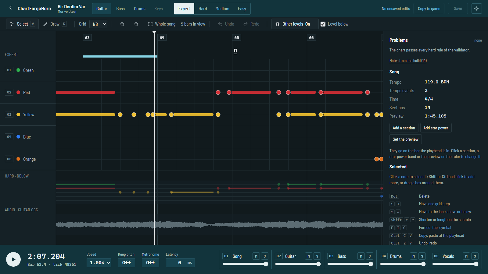
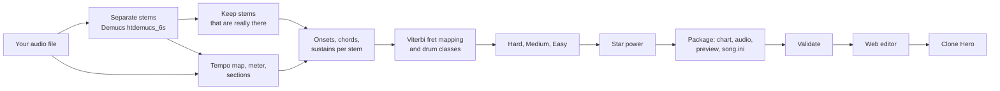

# ChartForgeHero

**Turn a song you own into a playable [Clone Hero](https://clonehero.net/) chart: guitar, bass, drums and keys at four difficulties, then fix anything you like in a local web editor and copy it straight into the game.**



ChartForgeHero separates a song into stems with [Demucs](https://github.com/facebookresearch/demucs), finds its tempo map, charts each instrument the way a human charter would (playable, not a literal transcription) and packages a song folder the game can load. It is measured against charts made by people, with a train/test split, and guarded by more than 1,300 tests.

It only processes local audio files you give it. It does not download audio or touch streaming services.

## Highlights

- **Four instruments, four difficulties.** Guitar and bass on five frets with sustains (chords on guitar; bass plays single notes), 4-lane Pro Drums with cymbals, and keys. Hard, Medium and Easy are reduced from Expert by musical importance (beat strength, phrase position, held notes), never by deleting every Nth note.
- **Playable fret mapping.** A Viterbi search follows the melodic contour of each phrase instead of pinning pitches to frets, so a riff keeps its shape wherever it is played.
- **A tempo map you can trust.** Whole-song tempo analysis with explained tempo events, a drum-based check of the beat phase, fast songs recognised from the snare backbeat, and a click track you can listen to.
- **Song structure.** Sections named by structure (`A1`, `B1`, `A2`...), a preview point, and star power phrases on every instrument.
- **A local web editor.** See the chart over time, play it in sync with the stems, edit notes, sections and star power, save with automatic backups, and copy the song into the game in one click.
- **Safe by design.** A validator checks every build and every save; an invalid chart is never written; hand edits are never silently overwritten by a rebuild.

## Quick start

Needs Python 3.11 or newer; developed and tested on Windows, and the commands below are for Windows. No external programs: audio is read and encoded by libsndfile.

```
python -m venv .venv
.venv\Scripts\activate
pip install torch --index-url https://download.pytorch.org/whl/cpu
pip install -e ".[separation,editor,dev]"
```

Build a song, open it in the editor, and play it:

```
python -m chartgen build song.mp3 --artist "Artist" --title "Title"
chartgen edit
```

The song folder appears in `outputs/Artist - Title/`. In the editor, **Copy to game** puts it into Clone Hero's `Songs` folder; in the game, run *Settings > General > Scan Songs* if it does not show up yet.

The first build downloads the Demucs `htdemucs_6s` weights. Without a GPU, separating a three-to-four-minute song took 74 to 99 seconds on a 16-thread CPU; every song is separated once and its stems are cached.

The project is named ChartForgeHero; its Python package and command keep the name `chartgen`.

## How it works



1. **Separate** the song into six stems, cached by the file's SHA-256 and seeded so the same file always gives the same stems.
2. **Check presence**: a stem that is only bleed from other instruments gets no chart; its audio moves to the backing track instead of vanishing.
3. **Track tempo** once on the mix, shared by every instrument. The whole-song analysis looks between 60 and 160 BPM, so a faster song is first found at half its tempo; the drum stem checks the beat phase, and when the snare falls on every beat the tempo is doubled (up to 230 BPM): that is how fast songs are recognised. A region gets its own tempo event only when that brings its onsets closer to the grid, and `analysis.json` records why.
4. **Find sections** where the texture changes, bar by bar, named by structure.
5. **Find notes** on each stem behind a noise gate and an adaptive threshold, and drop traces of the vocals that leak into instrument stems.
6. **Map to frets** with the Viterbi algorithm (guitar, bass, keys) or classify kick, snare, toms, hi-hat, ride and crash (drums).
7. **Reduce** Expert to Hard, Medium and Easy under hard rules that keep every level playable: each level's notes come from the level above, no chords on Easy, no orange on Medium and Easy. Then star power goes on every instrument, every few bars.
8. **Package and verify**: the chart, the audio files, a preview that runs into a part already heard once, and `song.ini`; every encoded file is decoded again and checked, and the folder must pass an independent validator. A failed build leaves nothing behind.

Each step in more detail: [docs/USAGE.md](docs/USAGE.md#what-a-build-does). The full specification and every design decision are in [docs/SPEC.md](docs/SPEC.md).

## Results against human charts

ChartForgeHero is tuned and scored against 12 charts made by people (8 for tuning, 4 held out for testing). Settings are only ever tuned on the training songs; the test songs are measured once per change, after the settings are frozen.

| Note F1 against the human chart, training songs | Expert | Hard | Medium | Easy |
|---|---|---|---|---|
| Guitar | 0.762 | 0.718 | 0.643 | 0.626 |
| Bass | 0.824 | 0.796 | 0.785 | 0.744 |
| Drums (positions) | 0.889 | 0.868 | 0.907 | 0.862 |

On the four held-out test songs, guitar Expert scores 0.684 on average (median 0.744).

Each lower difficulty is also scored next to two naive reductions of the same Expert chart (keeping every Nth note, keeping beats first); on the reference song the tests use, the drum levels must beat both and the bass levels must beat beats first. How the evaluation works and where its settings live: [docs/EVALUATION.md](docs/EVALUATION.md).

## The editor

`chartgen edit` serves a local page on `127.0.0.1` only; nothing is sent anywhere and the page loads nothing from the internet.

- **See** one instrument and difficulty at a time, with the level below it faint, bars, tempo changes, sections, star power and the validator's problems in plain words.
- **Hear** the stems in sync with the chart, with mute, solo, a metronome, latency compensation and slow-down that keeps the pitch.
- **Edit** with a select and a draw tool, a grid of 1/4, 1/8 or 1/16 or the triplet grids 1/12 and 1/24, keyboard shortcuts, and undo and redo. Changes to one level can flow to the levels above and below so they stay consistent.
- **Save** only charts that pass the validator, with a backup of the previous files on every save and a draft kept after every edit.
- **Copy to game** with one click, refused while Clone Hero is running, with a backup of what it replaces.

The full guide, with every shortcut: [docs/EDITOR.md](docs/EDITOR.md).

## Status and known limits

| | State |
|---|---|
| Guitar, bass | Four difficulties; played and approved in the game |
| Pro Drums | Four difficulties with cymbals; played in the game; toms and the crash are not verified on real data |
| Keys | Four difficulties; tested on synthetic audio only |
| Vocals | Separate `vocals.ogg` for the game's volume control; no lyrics |
| Structure | Sections, preview and star power; drum star power activation is untested in the game |
| Editor | Complete: view, play, edit, save, copy to game |

Other known limits: the settings come from a small set of mostly rock songs, so very different genres may chart less well; telling chords from single notes on heavily distorted guitar is unverified; 3/4 and 6/8 have only been tested on synthetic audio; tempo changes cannot be edited yet; stems are verified to be identical run to run on CPU only. The project's working notes and open items are in [docs/STATUS.md](docs/STATUS.md) (in Turkish).

More on building songs, the output files, previewing with bots and checking the tempo by ear: [docs/USAGE.md](docs/USAGE.md).

## Development

```
pytest                    # every test but real Demucs and your own songs; separation is mocked
pytest -m slow            # real Demucs on synthetic audio
pytest -m real            # your songs and the references; set CHARTGEN_MUSIC_DIR and CHARTGEN_REFERENCE_DIR
scripts\check.ps1         # quick tests, the editor's JavaScript and the validator, a few minutes; runs on every commit
scripts\check.ps1 -Mid    # every test but the real songs and references
scripts\check.ps1 -Full   # everything: real Demucs, real songs, references and browser tests; before a phase commit
npm ci --prefix tests\browser            # Playwright 1.65.1, for the browser tests
node --test "tests/js/*.test.mjs"        # the editor's JavaScript alone
git config core.hooksPath .githooks       # makes every commit run the quick check
```

Hard rules live in code and in the validator; soft targets live in `.toml` files and only warn. The editor's JavaScript is tested with Node's built-in runner and its pages with Playwright. The check also validates every song folder in `outputs/` except those whose name starts with `_`, such as `outputs/_songs_backup/`, where old copies of song folders from the game are kept.

```
chartgen/
  core/        chart model, tempo map, drum kit, exporter interface (knows nothing about Clone Hero)
  audio/       loading, separation, presence, tempo, meter, sections, onsets, pitch, sustain,
               vocal bleed, drum hits
  chart/       charting, fret mapping, HOPOs, difficulty reduction, drums, sections, preview,
               star power, and their settings
  clonehero/   .chart reader and writer, song.ini, packaging, validation, edit protection,
               click and drum listening files
  editor/      the local web editor: server, edit operations, saving and copying, the page
  evaluation/  reference charts and metrics
  pipeline.py  the build, stage by stage
  protect.py   chartgen protect: which song folders a rebuild may replace
  cli.py       command line
```

## Notes

ChartForgeHero is an independent project and is not affiliated with Clone Hero or with the makers of Guitar Hero. Use it with audio you own. Stem separation uses [Demucs](https://github.com/facebookresearch/demucs) (MIT). The editor ships the Barlow Semi Condensed and Cascadia Mono fonts under the SIL Open Font License.

## License

MIT; see [LICENSE](LICENSE).
